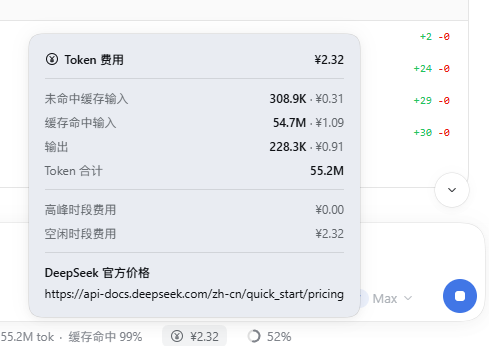

# dsh-token-cost

[](https://github.com/ZombieStiffMann/dsh-token-cost/actions/workflows/test.yml)
[](LICENSE)

[English](README.md) | **中文**

一个 [DeepSeek Harness](https://deepseek-harness.github.io/deepseek-harness/) 插件：
在输入框下方、内置 token 用量胶囊旁边，显示**当前会话到目前为止花了多少钱**。
它按每个用量样本实际发生的模型和官方价格计价，支持 **17 家厂商**（人民币 / 美元）：
DeepSeek、通义千问 Qwen、智谱 GLM、Kimi、豆包 Doubao、混元 Hunyuan、文心 ERNIE、
MiniMax、阶跃 StepFun、商汤 SenseNova、小米 MiMo，以及 OpenAI、Anthropic Claude、
Google Gemini、xAI Grok、Mistral AI、Cohere；弹框中按模型分 Tab 查看明细。

> 第三方非官方插件，与任何厂商都没有隶属或背书关系。
> 费用为估算值，最终以官方账单为准。

## 预览

费用胶囊排在 Harness 自带的 activity / 用量胶囊之后。点开后每个模型有独立 Tab，
每个 Tab 只展示该模型真实存在的计费维度：



标题栏的扳手按钮打开语言与显示货币设置（见 [设置](#设置)）。

```text
Token 费用                              ¥2.32
──────────────────────────────────────────────
[ DeepSeek-V4.1-Flash ¥1.97 ] [ MiMo-V2.6-Pro ¥0.35 ]
──────────────────────────────────────────────
未命中缓存输入       288.3K        ¥0.29
缓存命中输入          44.2M        ¥0.88
输出                 198.2K        ¥0.79
Token 合计            44.7M
──────────────────────────────────────────────
高峰时段费用                        ¥0.00
空闲时段费用                        ¥1.97
```

上面的 DeepSeek Tab 展示缓存命中/未命中，并且有**高峰/空闲时段**费用，因为
DeepSeek 按时段计费。扁平价厂商（MiMo、Qwen、GLM、Kimi……）的 Tab 不同：只显示
缓存命中/未命中输入和输出，并用一行说明该厂商没有峰谷时段。每个 Tab 还会在官方
价格链接旁标注**价格数据日期**，方便判断数据新旧。

国际模型按美元计价：对应 Tab 显示 `$` 金额；同时使用两种币种时，胶囊并排显示
（`¥2.32 · $0.14`），但绝不会相加或换算。

## 支持的厂商

价格取自各厂商自己的官方价格页，随版本更新；只有 DeepSeek 会在后台自动刷新官方
价格页。每家的来源 URL 和读取日期都在 `catalog/china/notes/` 与
`catalog/world/notes/`。中国厂商以人民币（CNY）计价：

| 厂商 | 建议的 DSH provider id | 模型数 | 官方价格来源 |
|---|---|---|---|
| DeepSeek | `deepseek-official`、`deepseek-account` | 2 | <https://api-docs.deepseek.com/zh-cn/quick_start/pricing>（自动刷新） |
| 智谱 AI (GLM) | `zai` | 12 | <https://docs.bigmodel.cn/cn/guide/start/pricing> |
| 阿里云百炼 (Qwen) | `dashscope` | 22 | <https://help.aliyun.com/zh/model-studio/model-pricing> |
| 字节跳动火山方舟 (Doubao) | `volcengine` | 10 | <https://docs.volcengine.com/docs/ark/model-pricing> |
| 腾讯混元 (Hunyuan) | `hunyuan` | 7 | <https://cloud.tencent.com/document/product/1823/130055> |
| 百度智能云千帆 (ERNIE) | `qianfan` | 5 | <https://cloud.baidu.com/doc/qianfan/s/wmh4sv6ya> |
| 月之暗面 Kimi | `moonshotai-cn`、`moonshotai` | 4 | <https://platform.kimi.com/docs/pricing/chat> |
| MiniMax | `minimax-cn`、`minimax` | 2 | <https://platform.minimax.cn/docs/pricing/overview> |
| 阶跃星辰 StepFun | `stepfun` | 4 | <https://platform.stepfun.com/docs/zh/guides/pricing/details> |
| 商汤日日新 SenseNova | `sensenova` | 8 | <https://console.sensecore.cn/micro/help/docs/model-as-a-service/nova/pricing/> |
| 小米 MiMo | `xiaomi` | 3 | <https://mimo.mi.com/docs/zh-CN/price/pay-as-you-go> |

国际厂商以美元（USD）计价（2026-10-20 读取）：

| 厂商 | 建议的 DSH provider id | 模型数 | 官方价格来源 |
|---|---|---|---|
| OpenAI | `openai`（另有 `azure`） | 19 | <https://developers.openai.com/api/docs/pricing> |
| Anthropic (Claude) | `anthropic` | 15 | <https://platform.claude.com/docs/en/about-claude/pricing> |
| Google Gemini | `google`、`google-vertex` | 10 | <https://ai.google.dev/gemini-api/docs/pricing> |
| xAI (Grok) | `xai` | 8 | <https://docs.x.ai/developers/pricing> |
| Mistral AI | `mistral` | 8 | <https://docs.mistral.ai/inference/pricing.md> |
| Cohere | `cohere`（手写路由名） | 6 | <https://cohere.com/pricing> |

provider id 只是提示：优先按模型的 wire id 精确匹配，其次 alias（包括 DSH pi-ai
实际下发的 id，例如 `mistral-medium-3.5`），再次官方文档化的快照前缀；所以即使你
自选了 pi-ai provider 名，模型仍能匹配上。任何目录里都没有的模型会显示「未定价」，
不会被当成免费。

要使用国外厂商，还需要在 pi-ai 配置里为它加一条路由（profile patch 的
`providers` 条目 + API key）；插件只会给真正产生用量的模型计价。本机 DSH 版本
装了哪些 provider id、各自有哪些模型 id，见
`catalog/world/notes/provider-map.md`。

## 费用如何计算

对每个持久化的 `assistant/message` / `assistant/attempt` 用量样本：

```text
费用 = Σ 各计费桶 tokens × 官方单价(桶) × 时段系数(样本时间)
```

- 四个计费桶：缓存命中输入、缓存未命中输入、缓存写入输入、输出。推理 token 已包含
  在输出里，不会重复计费；没有单独缓存写入价的厂商，写入按未命中输入价计。
- **DeepSeek** 使用官方峰谷时段：高峰期 = 北京时间（UTC+8）周一至周五
  09:00–12:00、14:00–18:00（中国法定节假日除外），其余为空闲时段，空闲价为高峰价
  的 50%。`catalog/china/` 与 `catalog/world/` 里的厂商默认扁平价，除非其数据里带
  `billing` 块。
- 按上下文长度分档的模型，会用包含本次请求 prompt 大小的那一档（OpenAI 长上下文、
  xAI 长上下文、Gemini 长上下文、Claude Haiku 5.5 以及部分中国厂商用到）。
- 默认情况下不同币种不会相加：同时使用人民币和美元模型时显示
  `¥1.23 · $0.45`，每个模型 Tab 保留自己的币种。可选的「显示货币」设置会按用户
  设定的汇率**只做显示换算**，存储的金额和官方账单仍以厂商原币种为准。
- 样本的合并（替换 / 重试）规则与 Harness 自带的 `tokenUsage` 投影一致，所以 token
  总数与内置用量胶囊对得上。

## 价格数据

- **DeepSeek** 自动刷新：启动时（先用本地缓存）以及之后每 24 小时抓取
  <https://api-docs.deepseek.com/zh-cn/quick_start/pricing>，成功后只影响之后发生的
  用量。网络或页面结构异常时保留上一份价格；能识别时也会采纳解析出的比例/时段变化。
- **其他厂商**是仓库里的数据文件：`catalog/china/`（人民币）、`catalog/world/`
  （美元）。它们在仓库中维护更新（见 [添加或更新厂商](#添加或更新厂商)），不在运行时
  抓取——所以不会出现第三方网页偷偷注入价格的情况。
- 人工维护的价格带有读取日期。少数是促销价，之后会变（OpenAI GPT-5.6 Sol 至少到
  2026-11-21；Gemini 4 Argon 到 2026-11-30；Gemini 3.8/3.6 Flash 到
  2026-12-31；Mistral Large 4 Public Preview）。每家 notes 里都记录了原价和变更日期。
- 已经计过的 token 会保留其发生时的费用；刷新价格或升级版本只影响之后的样本。
- 不发送任何会话内容、token 文本或标识符。唯一的外部请求是抓取 DeepSeek 价格页，
  可用 `refresh: false` 关闭。

## 安装

要求：带 Plugin Manager（`plugin_manager` 工具或 **Plugins** 页面）的 DeepSeek
Harness，以及从 GitHub 安装所需的 `git` 和网络。

```text
plugin_manager install_bundle target=github:ZombieStiffMann/dsh-token-cost
```

固定到某个版本：

```text
plugin_manager install_bundle target=github:ZombieStiffMann/dsh-token-cost#v0.1.0
```

本地开发时可以直接指向 checkout 目录：

```text
plugin_manager install_bundle target=<本目录绝对路径>
```

首次安装后刷新页面，让新的客户端模块加载。以后可以在 **Plugins** 页面删除或禁用
（或执行 `plugin_manager remove_bundle target=dsh-token-cost`）。

## 设置

在费用弹框内，标题栏的扳手按钮会打开一个小设置页（跟随插件语言，中英双语）：

- **界面语言**：跟随应用 / 中文 / English。插件内置中英文字典；默认跟随应用语言，
  手动选择后本插件所有文字立即切换。
- **显示货币**：原币种 / CNY ¥ / USD $。默认「原币种」：每个模型 Tab 和胶囊按厂商
  自己的币种显示，混合会话并排显示两种币种且不换算。选择 CNY 或 USD 后，所有显示的
  金额都会按设定汇率换算成同一种货币，并只显示一个总额。
- **汇率**：1 USD 等于多少 CNY（默认 7.20），可编辑。换算只是**用户设定汇率的显示
  估算**，不会改变 Host 记账、已存储的分币种金额或官方账单。换算模式下弹框会显示
  当前汇率并标注「估算」。

偏好保存在浏览器 `localStorage`（key 为 `dsh-token-cost.settings.v1`），刷新后保留。
插件仍同时注册中英文，默认跟随 Harness 语言。

## 配置

在 profile patch 层（`%DSH_PROFILE_DIR%\cordis.patch.yml`，它会在所有 bundle 层
之后应用）覆盖 `token-cost` 这一行。所有字段都是可选的；显式配置的模型优先于目录
数据和自动抓取的价格。

```yaml
- id: token-cost
  name: 'dsh-token-cost'
  config:
    # DeepSeek 官网价格刷新（其他厂商为仓库内数据）
    refresh: true            # false = 只用缓存/内置目录
    refreshHours: 24         # 1..168
    priceUrl: 'https://api-docs.deepseek.com/zh-cn/quick_start/pricing'

    # 按 wire id 覆盖目录中的模型（未写的费率继承），或新增目录里没有的模型
    models:
      deepseek-flash:
        rates: { cacheMiss: 2, cacheHit: 0.04, output: 8 }
      my-custom-model:
        name: My Custom Model
        rates: { cacheMiss: 10, cacheHit: 1, output: 20 }
        currency: { code: CNY, symbol: '¥' }
        source: 'https://example.com/pricing'
      my-usd-model:
        name: My USD Model
        rates: { cacheMiss: 3, cacheHit: 0.3, output: 15 }
        currency: { code: USD, symbol: '$' }
        source: 'https://example.com/usd-pricing'

    # 全局 id alias（wire id -> 目录模型 id）和兜底价格
    aliases: { my-alias: glm-4.6 }
    fallbackModel: deepseek-v4-pro

    # DeepSeek 时段（北京时间，[开始分钟, 结束分钟)）
    peakWindows: [[540, 720], [840, 1080]]
    offPeakMultiplier: 0.5
    timeZoneOffsetMinutes: 480
    additionalHolidays: ['2027-01-01']
```

2026 年中国法定节假日已内置（国办发明电〔2025〕7号）。之后公布的日期可用
`additionalHolidays` 追加。

## 添加或更新厂商

价格目录就是普通数据，一个厂商一个文件：

1. 把 `catalog/china/_template.js` 复制成 `catalog/china/<vendor>.js`（人民币）或
   `catalog/world/<vendor>.js`（美元），填写 `vendor`、显示名、官方 `source` URL、
   `asOf`、`providers`，以及各模型费率。先读 `catalog/china/SCHEMA.md` 和
   `catalog/world/SCHEMA.md`；目录决定币种（`china/` = CNY/¥，`world/` = USD/$）。
2. 添加 `catalog/china/notes/<vendor>.md` 或 `catalog/world/notes/<vendor>.md`，
   写清来源 URL、读取日期、收录/排除原因。
3. 运行 `npm run validate:catalog` 和 `npm test`。校验器会检查两个目录，拒绝格式
   错误的费率、日期、时段、重复 id、rates/tiers 冲突和与目录不符的币种。
4. 提 PR。不要猜价格：没有官方价格就不收录（显示「未定价」），不要发布未核实的数字。

## 开发

| 路径 | 作用 |
|---|---|
| `index.js` | Host 端：`tokenCost` 投影、逐样本计价、DeepSeek 刷新/缓存 |
| `pricing.js` | DeepSeek 目录默认值、配置归一化、峰谷规则 |
| `cost-catalog.js` | 运行时目录：人工维护厂商 + DeepSeek + 用户覆盖/alias/兜底 |
| `catalog/index.js` | `catalog/china/*.js` + `catalog/world/*.js` 的同步加载/归一化 |
| `catalog/lookup.js` | provider → 模型 id → alias → 前缀匹配，档位选择 |
| `catalog/validate.js` | 数据契约校验器与加载核心（两个目录） |
| `catalog/china/` | 人工维护的人民币厂商价格数据 + 每家证据 notes |
| `catalog/world/` | 人工维护的美元厂商价格数据 + 证据 notes + provider 映射 |
| `client.js` | 客户端：费用胶囊与按模型 Tab 的明细弹框 |
| `cordis.patch.yml` | 插入 Host `token-cost` 行的 bundle patch |
| `test/` | Host 折叠、官网页解析器、目录引擎与客户端渲染测试 |

离线运行全部测试（Node 20+；CI 跑 20/22/24）：

```bash
npm test                 # 全部测试
npm run test:fold        # 计价折叠、峰谷、重试/替换、多币种
npm run test:parser      # DeepSeek 官网页解析器（针对精简 fixture）
npm run test:catalog     # 目录加载/校验 + 多厂商查找引擎
npm run test:component   # 在无 DOM 的 stub 中渲染真实 client.js
npm run validate:catalog # catalog/china + catalog/world 数据契约校验
```

零依赖、无构建步骤：全部是普通 ESM/JS。

## 兼容性

- 在 DeepSeek Harness **0.2.1-rc.2**（桌面版、Windows 11、Web UI）上测试通过。
- 只使用公开的插件接口：一个 Host session projection
  （`ctx.sessionProjections`）和一个 `conversation.composer.dock` slot 条目。
- Harness 仍处于 developer preview，插件接口可能随版本变化。

## 已知限制

- 仅为估算。官方账单才是准的，且价格会变——人工维护的数据带 `asOf` 日期，随版本
  更新。
- **货币换算只影响显示。** 设置中选择 CNY 或 USD 会按你填的汇率（默认
  1 USD = 7.20 CNY）换算；它不是银行/信用卡汇率，也不会改变存储的分币种金额或
  官方账单。需要厂商原始币种精确数字时请用「原币种」。
- **Batch / flex / priority / fast / 订阅套餐未建模。** 目录里是厂商标准按量在线价
  （batch 通常只有它的 50–60%）；编码/token 套餐属于订阅，其单 token 成本不可比。
- **国外厂商只给 pi-ai 配置里真正路由到的用量计价。** 没有路由/API key 的厂商不会
  产生用量；通过任意 provider 名路由的模型仍按 wire id 匹配。
- **转售/企业路由可能不同价。** 美元价格取厂商第一方 API 价目；Azure、Amazon
  Bedrock、Google Vertex、OpenRouter 等网关费率可能不同，所以通过它们路由的模型
  会按第一方价格计算。`azure` provider 提示只是尽力而为。
- **免费模型目前无法表示**：¥0 / $0 的模型会显示「未定价」而不是 `¥0.00`。
- 有些厂商是二维定价（输入长度 × 输出长度）或区分思考/非思考输出价；目录取其中
  一个档（在厂商 notes 中说明），边缘情况可能差一个常数倍。
- 部分模型 id 是按厂商文档的命名规律推断的；未知 id 只会保持「未定价」。
- **国外缓存细节**：Anthropic 缓存写入按标准 5 分钟 TTL 价记录（1 小时 TTL 是输入的
  2 倍，无法用一个数字表示）；Gemini 上下文缓存存储按 token-小时计费，未建模；xAI
  没有缓存写入价，写入按普通输入计。Provider 上报的缓存读取 token 会按厂商公布的
  缓存命中价计算。
- 促销价按当前生效价格记录；厂商 notes 里会写原价和官方公布的变更日期（例如
  Gemini 4 Argon 到 2026-11-30、OpenAI GPT-5.6 Sol 至少到 2026-11-21、
  Mistral Large 4 Public Preview）。
- 动态 alias（`chat-latest`、`gemini-flash-latest` 等）随时可能指向不同快照；它们
  要么带说明收录，要么保持「未定价」，不猜测。
- 讯飞星火暂未收录：其官方页面上的实时价与静态折扣价存在冲突。见
  `catalog/china/notes/xunfei.md`；欢迎带可核实 id + 价格的 PR。
- fork 会话会包含继承的前缀费用，与 Harness 自带的 `tokenUsage` 投影一致。
- 2026-08-16（DeepSeek 峰谷价开始）之前消费的 token 按当前价格表和峰谷规则计价，
  这是有意为之。

## 许可证

[MIT](LICENSE) © 2026 zombiestiffmann。

DeepSeek、Qwen、GLM、Kimi、豆包、混元、文心、MiniMax、StepFun、SenseNova、
MiMo、OpenAI、ChatGPT、Claude、Anthropic、Gemini、Google、Grok、xAI、Mistral、
Cohere 等名称归各自所有者。官方价格数据仅以简短事实（费率 + 来源链接）形式转载，
用于费用估算。
